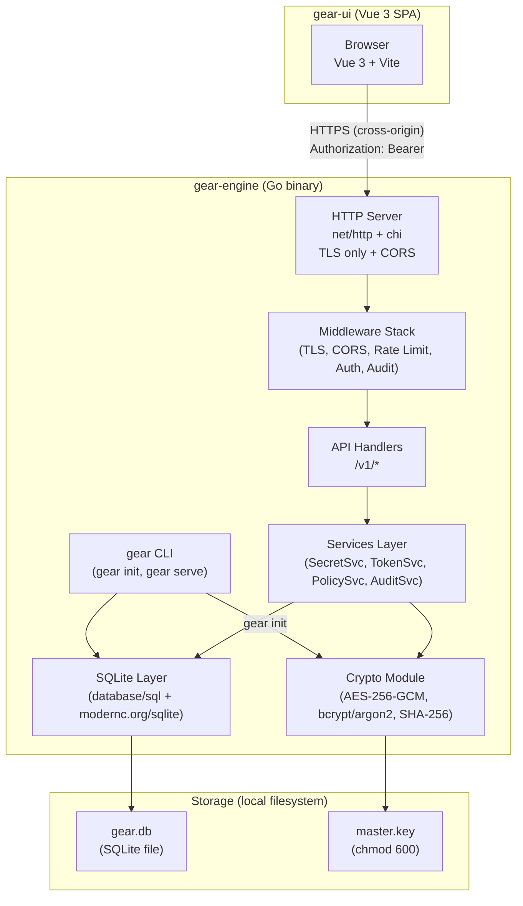
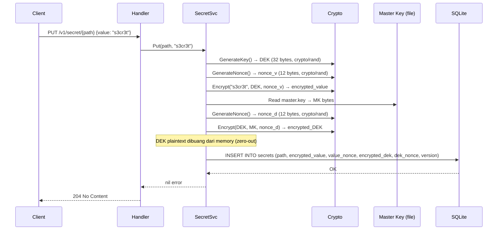
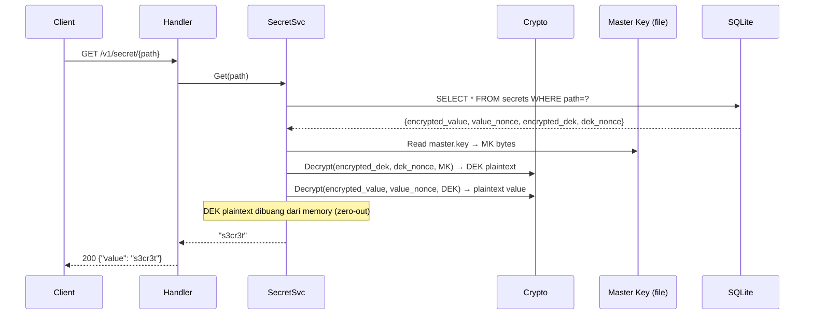

# Design Document: Gear Secret Management

## Overview

Gear adalah tool manajemen secret berbasis envelope encryption yang terinspirasi dari HashiCorp Vault. Backend ditulis dalam Go menggunakan `net/http` standar, database SQLite, dan enkripsi AES-256-GCM. Frontend adalah dashboard Vue 3 SPA yang berjalan sebagai project terpisah. Fase 1 fokus pada MVP lokal dengan TLS wajib, autentikasi admin + token, policy per-path, dan audit log lengkap.

**Keputusan desain utama:**
- **Dua project terpisah**: `gear-engine` (Go backend) dan `gear-ui` (Vue 3 SPA) — tidak ada embed; masing-masing di-deploy dan di-develop secara independen
- Net/http standar + [chi router](https://github.com/go-chi/chi) sebagai router ringan (zero dependency transitive, 100% compatible `http.Handler`)
- Envelope encryption per-secret: setiap secret punya DEK sendiri, DEK dienkripsi Master Key — kompromi database tanpa Master Key tidak mengekspos secret
- Master Key disimpan terpisah dari database (file sistem, chmod 600) — defence-in-depth
- Token hashing SHA-256: token plaintext tidak pernah ada di database, hanya hash-nya
- **CORS**: backend mengizinkan origin UI via `GEAR_CORS_ORIGIN`; UI mengkonfigurasi base URL backend via `VITE_API_BASE_URL`

---

## Architecture



**Alur request tipikal (GET secret):**
```
Browser (gear-ui) → HTTPS cross-origin → CORS Middleware → chi Router
       → RateLimitMiddleware → AuthMiddleware (validate token hash)
       → PolicyMiddleware (check path permission) → SecretHandler
       → SecretService.Get() → decrypt DEK with MasterKey → decrypt secret with DEK
       → AuditMiddleware.Log() → Response
```

**Deployment topology:**
```
[gear-engine binary]          [gear-ui static files]
  :8443 (HTTPS/TLS)    ←→     :5173 dev / nginx prod
  GEAR_CORS_ORIGIN=           VITE_API_BASE_URL=
    https://ui.host              https://api.host:8443
```

---

## Components and Interfaces

### Project Structure

Dua project/repository terpisah:

#### `gear-engine/` — Go Backend

```
gear-engine/
├── cmd/
│   └── gear/
│       └── main.go              # Entry point: route subcommands (init, serve)
├── internal/
│   ├── cli/
│   │   └── init.go              # gear init command logic
│   ├── config/
│   │   └── config.go            # Config struct (TLS paths, DB path, master key path,
│   │                            #   TTL, rate limit, CORS allowed origins)
│   ├── crypto/
│   │   ├── aes.go               # AES-256-GCM encrypt/decrypt (DEK ↔ secret, MasterKey ↔ DEK)
│   │   ├── keygen.go            # crypto/rand key generation (Master Key, DEK, token)
│   │   └── password.go          # bcrypt/argon2 hash & verify
│   ├── database/
│   │   ├── db.go                # SQLite open, migrate, close
│   │   └── migrations/
│   │       └── 001_init.sql     # DDL untuk semua tabel
│   ├── middleware/
│   │   ├── auth.go              # Token extraction, SHA-256 hash, DB lookup, TTL check
│   │   ├── audit.go             # Post-handler audit log writer
│   │   ├── cors.go              # CORS handler: validate Origin vs GEAR_CORS_ORIGIN whitelist
│   │   ├── ratelimit.go         # In-memory IP-based rate limiter (sliding window)
│   │   └── tls.go               # HTTP→HTTPS redirect + strict TLS config
│   ├── handler/
│   │   ├── auth.go              # POST /v1/auth/login, POST /v1/auth/logout
│   │   ├── secret.go            # GET/PUT/DELETE /v1/secret/{path}, GET /v1/list/{prefix}
│   │   ├── token.go             # POST /v1/token, GET /v1/token, DELETE /v1/token/{id}
│   │   ├── policy.go            # POST /v1/policy, GET /v1/policy, DELETE /v1/policy/{id}
│   │   └── audit.go             # GET /v1/audit
│   ├── service/
│   │   ├── secret.go            # SecretService: Get, Put, Delete, List
│   │   ├── token.go             # TokenService: Create, Revoke, Validate
│   │   ├── policy.go            # PolicyService: Create, Delete, Evaluate
│   │   └── audit.go             # AuditService: Log, Query
│   ├── model/
│   │   └── model.go             # Go structs: Secret, Token, Policy, AuditEntry, Admin
│   ├── validate/
│   │   └── path.go              # Path validation: allowed chars, max length, traversal detection
│   └── server/
│       └── server.go            # HTTP server setup, route registration, graceful shutdown
├── go.mod
└── Makefile                     # build, test
```

#### `gear-ui/` — Vue 3 SPA

```
gear-ui/
├── src/
│   ├── views/
│   │   ├── Login.vue
│   │   ├── Secrets.vue
│   │   ├── SecretDetail.vue
│   │   ├── Tokens.vue
│   │   ├── Policies.vue
│   │   └── AuditLog.vue
│   ├── components/
│   │   ├── SecretTree.vue
│   │   ├── TokenCard.vue
│   │   └── AuditTable.vue
│   ├── api/
│   │   └── client.ts            # Axios/fetch wrapper:
│   │                            #   - Base URL dari import.meta.env.VITE_API_BASE_URL
│   │                            #   - Inject Authorization: Bearer {token} header
│   │                            #   - Intercept 401 → redirect /login
│   │                            #   - Intercept 403 → toast "Forbidden"
│   ├── store/
│   │   └── auth.ts              # Pinia store: session token, expiry, auto-logout
│   └── router/
│       └── index.ts             # vue-router: guard redirect ke /login jika no session
├── .env.example                 # VITE_API_BASE_URL=https://localhost:8443
├── .env.local                   # (gitignored) override lokal
├── vite.config.ts
├── package.json
└── dist/                        # Build output untuk static hosting / nginx
```

### Key Interfaces (Go)

```go
// internal/service/secret.go
type SecretService interface {
    Put(ctx context.Context, path, value string) error
    Get(ctx context.Context, path string) (string, error)
    Delete(ctx context.Context, path string) error
    List(ctx context.Context, prefix string) ([]string, error)
}

// internal/service/token.go
type TokenService interface {
    Create(ctx context.Context, name string, ttl time.Duration) (plaintext string, id int64, err error)
    Revoke(ctx context.Context, id int64) error
    Validate(ctx context.Context, plaintext string) (*model.Token, error)
    List(ctx context.Context) ([]model.Token, error)
}

// internal/service/policy.go
type PolicyService interface {
    Create(ctx context.Context, tokenID int64, pathPattern string, perms []string) error
    Delete(ctx context.Context, id int64) error
    Evaluate(ctx context.Context, tokenID int64, path, action string) (bool, error)
}

// internal/service/audit.go
type AuditService interface {
    Log(ctx context.Context, entry model.AuditEntry) error
    Query(ctx context.Context, filter model.AuditFilter) ([]model.AuditEntry, error)
}

// internal/crypto/aes.go
type Encryptor interface {
    Encrypt(plaintext, key []byte) (ciphertext, nonce []byte, err error)
    Decrypt(ciphertext, nonce, key []byte) (plaintext []byte, err error)
    GenerateKey() ([]byte, error) // 32 bytes via crypto/rand
}
```

### Vue 3 UI Structure

```
gear-ui/src/
├── views/
│   ├── Login.vue          # Form login, POST /v1/auth/login, store token di Pinia
│   ├── Secrets.vue        # Tree browse secrets, GET /v1/list/{prefix}
│   ├── SecretDetail.vue   # Tampil/edit/hapus satu secret
│   ├── Tokens.vue         # Daftar token aktif, buat + revoke
│   ├── Policies.vue       # Manage policies per token
│   └── AuditLog.vue       # Tabel audit dengan filter
├── components/
│   ├── SecretTree.vue     # Recursive tree component dari flat path list
│   ├── TokenCard.vue      # Token display card (masked, copy plaintext on create)
│   └── AuditTable.vue     # Filterable table component
├── api/
│   └── client.ts          # Wrapper fetch/axios:
│                          #   - Base URL dari import.meta.env.VITE_API_BASE_URL
│                          #   - Inject Authorization: Bearer {token} header
│                          #   - Intercept 401 → redirect /login
│                          #   - Intercept 403 → toast "Forbidden"
├── store/
│   └── auth.ts            # Pinia:
│                          #   state: { token, expiresAt }
│                          #   action: login(), logout(), checkExpiry()
│                          #   Expiry timer: setInterval cek tiap 30 detik
└── router/
    └── index.ts           # Navigation guard: !auth → redirect /login
                           # Route: /, /secrets, /tokens, /policies, /audit
```

---

## Data Models

### SQLite Schema

```sql
-- migrations/001_init.sql

PRAGMA journal_mode = WAL;
PRAGMA foreign_keys = ON;

-- Admin user (single admin in Phase 1)
CREATE TABLE IF NOT EXISTS admins (
    id           INTEGER PRIMARY KEY AUTOINCREMENT,
    username     TEXT NOT NULL UNIQUE,
    password_hash TEXT NOT NULL,  -- bcrypt atau argon2 hash
    created_at   INTEGER NOT NULL  -- Unix timestamp
);

-- Secrets table with envelope encryption
CREATE TABLE IF NOT EXISTS secrets (
    id               INTEGER PRIMARY KEY AUTOINCREMENT,
    path             TEXT NOT NULL UNIQUE,    -- e.g. "app/db/password"
    encrypted_value  BLOB NOT NULL,           -- AES-256-GCM ciphertext dari DEK
    value_nonce      BLOB NOT NULL,           -- 12-byte nonce untuk enkripsi value
    encrypted_dek    BLOB NOT NULL,           -- DEK dienkripsi oleh Master Key
    dek_nonce        BLOB NOT NULL,           -- 12-byte nonce untuk enkripsi DEK
    version          INTEGER NOT NULL DEFAULT 1,  -- untuk versioning di masa depan
    created_at       INTEGER NOT NULL,
    updated_at       INTEGER NOT NULL
);

CREATE INDEX IF NOT EXISTS idx_secrets_path ON secrets(path);

-- Access tokens
CREATE TABLE IF NOT EXISTS tokens (
    id           INTEGER PRIMARY KEY AUTOINCREMENT,
    name         TEXT NOT NULL,               -- deskriptif, untuk display saja
    token_hash   TEXT NOT NULL UNIQUE,        -- SHA-256(plaintext_token), hex encoded
    expires_at   INTEGER,                     -- Unix timestamp; NULL = no expiry
    revoked      INTEGER NOT NULL DEFAULT 0,  -- 0=active, 1=revoked
    created_at   INTEGER NOT NULL
);

CREATE INDEX IF NOT EXISTS idx_tokens_hash ON tokens(token_hash);

-- Access policies (many-per-token)
CREATE TABLE IF NOT EXISTS policies (
    id           INTEGER PRIMARY KEY AUTOINCREMENT,
    token_id     INTEGER NOT NULL REFERENCES tokens(id) ON DELETE CASCADE,
    path_pattern TEXT NOT NULL,               -- e.g. "app/*" atau "app/db/password"
    can_read     INTEGER NOT NULL DEFAULT 0,
    can_write    INTEGER NOT NULL DEFAULT 0,
    can_delete   INTEGER NOT NULL DEFAULT 0,
    created_at   INTEGER NOT NULL
);

CREATE INDEX IF NOT EXISTS idx_policies_token ON policies(token_id);

-- Audit log (append-only)
CREATE TABLE IF NOT EXISTS audit_log (
    id           INTEGER PRIMARY KEY AUTOINCREMENT,
    token_id     INTEGER,                     -- NULL jika unauthenticated attempt
    token_name   TEXT,                        -- snapshot nama token saat kejadian
    path         TEXT,                        -- path yang diakses (bisa NULL untuk /auth)
    action       TEXT NOT NULL,               -- "read", "write", "delete", "list", "login", "token_create", dll.
    result       TEXT NOT NULL,               -- "success", "denied", "error"
    error_code   INTEGER,                     -- HTTP status code
    ip_address   TEXT,
    timestamp    INTEGER NOT NULL             -- Unix timestamp (nanosecond precision)
);

CREATE INDEX IF NOT EXISTS idx_audit_timestamp ON audit_log(timestamp);
CREATE INDEX IF NOT EXISTS idx_audit_token     ON audit_log(token_id);
CREATE INDEX IF NOT EXISTS idx_audit_path      ON audit_log(path);
```

### Go Model Structs

```go
// internal/model/model.go

type Secret struct {
    ID             int64
    Path           string
    EncryptedValue []byte
    ValueNonce     []byte
    EncryptedDEK   []byte
    DEKNonce       []byte
    Version        int
    CreatedAt      time.Time
    UpdatedAt      time.Time
}

type Token struct {
    ID        int64
    Name      string
    TokenHash string  // hex SHA-256
    ExpiresAt *time.Time
    Revoked   bool
    CreatedAt time.Time
}

type Policy struct {
    ID          int64
    TokenID     int64
    PathPattern string
    CanRead     bool
    CanWrite    bool
    CanDelete   bool
    CreatedAt   time.Time
}

type AuditEntry struct {
    ID        int64
    TokenID   *int64
    TokenName *string
    Path      *string
    Action    string
    Result    string
    ErrorCode *int
    IPAddress string
    Timestamp time.Time
}

type AuditFilter struct {
    TokenID   *int64
    Path      *string
    Since     *time.Time
    Until     *time.Time
    Result    *string
    Limit     int
    Offset    int
}
```

---

## Encryption / Decryption Flow

### Detail Alur Enkripsi (Store Secret)



### Detail Alur Dekripsi (Read Secret)



### AES-256-GCM Implementation Detail

```go
// internal/crypto/aes.go

// Encrypt mengenkripsi plaintext dengan key menggunakan AES-256-GCM.
// Nonce di-generate fresh via crypto/rand setiap kali.
// Output: ciphertext (termasuk GCM auth tag) + nonce yang digunakan.
func Encrypt(plaintext, key []byte) (ciphertext, nonce []byte, err error) {
    block, err := aes.NewCipher(key)  // key harus 32 bytes untuk AES-256
    gcm, err := cipher.NewGCM(block)
    nonce = make([]byte, gcm.NonceSize())  // 12 bytes
    if _, err = io.ReadFull(rand.Reader, nonce); err != nil {
        return nil, nil, err
    }
    ciphertext = gcm.Seal(nil, nonce, plaintext, nil)
    return ciphertext, nonce, nil
}

// Decrypt mendekripsi ciphertext dengan nonce dan key.
func Decrypt(ciphertext, nonce, key []byte) ([]byte, error) {
    block, _ := aes.NewCipher(key)
    gcm, _ := cipher.NewGCM(block)
    return gcm.Open(nil, nonce, ciphertext, nil)
}

// GenerateKey menghasilkan key AES-256 (32 bytes) via crypto/rand.
func GenerateKey() ([]byte, error) {
    key := make([]byte, 32)
    _, err := io.ReadFull(rand.Reader, key)
    return key, err
}
```

### Token Generation & Hashing

```go
// internal/crypto/keygen.go

// GenerateToken menghasilkan token string 32-byte entropy, hex-encoded (64 chars).
func GenerateToken() (plaintext string, err error) {
    b := make([]byte, 32)
    if _, err = io.ReadFull(rand.Reader, b); err != nil {
        return "", err
    }
    return hex.EncodeToString(b), nil
}

// HashToken menghitung SHA-256 dari token plaintext dan mengembalikan hex string.
func HashToken(plaintext string) string {
    h := sha256.Sum256([]byte(plaintext))
    return hex.EncodeToString(h[:])
}
```

---

## API Design

### Base URL: `https://{host}/v1`

Semua response menggunakan `Content-Type: application/json`. Autentikasi via header `Authorization: Bearer {token}` kecuali endpoint `/auth/login`.

### Authentication

#### `POST /v1/auth/login`
Login admin, dapatkan session token.

**Request:**
```json
{ "username": "admin", "password": "..." }
```

**Response 200:**
```json
{ "token": "...", "expires_at": "2025-01-01T00:00:00Z" }
```

**Response 401:**
```json
{ "error": "invalid credentials" }
```

**Response 429:**
```json
{ "error": "too many requests", "retry_after": 60 }
```

---

### Secrets

#### `PUT /v1/secret/{path}`
Simpan atau update secret (upsert). Auth: Bearer token + write permission.

**Request:**
```json
{ "value": "s3cr3t_value" }
```

**Response 204:** No Content (success)  
**Response 400:** Path tidak valid  
**Response 401:** Token tidak valid  
**Response 403:** Tidak ada write permission  

#### `GET /v1/secret/{path}`
Baca dan dekripsi secret. Auth: Bearer token + read permission.

**Response 200:**
```json
{ "path": "app/db/password", "value": "s3cr3t_value", "version": 1, "updated_at": "2025-01-01T00:00:00Z" }
```

**Response 404:** Path tidak ditemukan  

#### `DELETE /v1/secret/{path}`
Hapus secret beserta DEK. Auth: Bearer token + delete permission.

**Response 204:** No Content  
**Response 404:** Path tidak ditemukan  

#### `GET /v1/list/{prefix}`
List path di bawah prefix, tanpa mendekripsi nilai. Auth: Bearer token + read permission.

**Response 200:**
```json
{ "paths": ["app/db/password", "app/db/user", "app/redis/url"] }
```

**Response 404:** Tidak ada secret di bawah prefix  

---

### Tokens

#### `POST /v1/token`
Buat token baru. Auth: Admin session token.

**Request:**
```json
{ "name": "ci-pipeline", "ttl": "720h" }
```

**Response 201:**
```json
{ "id": 42, "token": "a1b2c3...", "name": "ci-pipeline", "expires_at": "2025-02-01T00:00:00Z" }
```

> **Catatan:** Field `token` hanya muncul di response ini satu kali. Request GET berikutnya tidak mengembalikan nilai token.

#### `GET /v1/token`
Daftar semua token aktif (tanpa plaintext). Auth: Admin session token.

**Response 200:**
```json
{
  "tokens": [
    { "id": 42, "name": "ci-pipeline", "expires_at": "2025-02-01T00:00:00Z", "revoked": false, "created_at": "..." }
  ]
}
```

#### `DELETE /v1/token/{id}`
Revoke token. Auth: Admin session token.

**Response 204:** No Content  
**Response 404:** Token tidak ditemukan  

---

### Policies

#### `POST /v1/policy`
Buat policy baru. Auth: Admin session token.

**Request:**
```json
{ "token_id": 42, "path_pattern": "app/*", "permissions": ["read", "write"] }
```

**Response 201:**
```json
{ "id": 7, "token_id": 42, "path_pattern": "app/*", "permissions": ["read", "write"] }
```

#### `GET /v1/policy`
Daftar semua policy, opsional filter by `?token_id=42`. Auth: Admin.

**Response 200:**
```json
{ "policies": [ { "id": 7, "token_id": 42, "path_pattern": "app/*", "permissions": ["read", "write"] } ] }
```

#### `DELETE /v1/policy/{id}`
Hapus policy. Auth: Admin.

**Response 204:** No Content  

---

### Audit Log

#### `GET /v1/audit`
Ambil audit log dengan filter. Auth: Admin session token.

**Query params:** `token_id`, `path`, `since` (RFC3339), `until` (RFC3339), `result` (success/denied/error), `limit` (default 100, max 1000), `offset`

**Response 200:**
```json
{
  "entries": [
    {
      "id": 1,
      "token_name": "ci-pipeline",
      "path": "app/db/password",
      "action": "read",
      "result": "success",
      "ip_address": "127.0.0.1",
      "timestamp": "2025-01-01T00:00:00Z"
    }
  ],
  "total": 150,
  "limit": 100,
  "offset": 0
}
```

---

## Security Design

### TLS Configuration

```go
// internal/server/server.go

tlsConfig := &tls.Config{
    MinVersion:               tls.VersionTLS12,
    PreferServerCipherSuites: true,
    CipherSuites: []uint16{
        tls.TLS_ECDHE_ECDSA_WITH_AES_256_GCM_SHA384,
        tls.TLS_ECDHE_RSA_WITH_AES_256_GCM_SHA384,
        tls.TLS_ECDHE_ECDSA_WITH_CHACHA20_POLY1305,
        tls.TLS_ECDHE_RSA_WITH_CHACHA20_POLY1305,
    },
    CurvePreferences: []tls.CurveID{tls.X25519, tls.CurveP256},
}
```

HTTP (plain) listener hanya menerima request untuk redirect 301 ke HTTPS. Jika tidak ada sertifikat TLS valid saat startup → log error fatal dan exit(1).

### Rate Limiting

Rate limiting in-memory (IP-based, sliding window) untuk endpoint `POST /v1/auth/login`:

```go
// internal/middleware/ratelimit.go
// Menggunakan sliding window counter per IP.
// Default: max 10 attempts per 5 minutes per IP.
// Konfigurasi: GEAR_RATE_LIMIT_MAX dan GEAR_RATE_LIMIT_WINDOW env vars.
// Response 429 menyertakan header Retry-After: {seconds}.
```

Untuk production pada VPS (di belakang reverse proxy), middleware membaca `X-Forwarded-For` atau `X-Real-IP` dengan validasi trusted proxy.

### Path Validation

```go
// internal/validate/path.go

var allowedPathPattern = regexp.MustCompile(`^[a-zA-Z0-9/_\-\.]+$`)

const maxPathLength = 512

func ValidatePath(path string) error {
    // 1. Panjang
    if len(path) > maxPathLength {
        return ErrPathTooLong
    }
    // 2. Traversal patterns
    if strings.Contains(path, "..") ||
        strings.Contains(path, "/./") ||
        strings.ContainsRune(path, 0) ||
        strings.HasPrefix(path, "/") {
        return ErrPathTraversal
    }
    // 3. Allowed characters only
    if !allowedPathPattern.MatchString(path) {
        return ErrInvalidPathChars
    }
    return nil
}
```

Path traversal violations dicatat ke audit_log dengan action `"security_violation"`.

### Middleware Stack (order penting)

```
chi.Router
├── middleware.RequestID
├── middleware.RealIP (dengan trusted proxy validation)
├── TLSRedirectMiddleware       # reject HTTP, redirect ke HTTPS
├── CORSMiddleware              # validate Origin vs GEAR_CORS_ORIGIN; set CORS headers
├── middleware.Logger           # request log (NO sensitive data)
├── middleware.Recoverer
├── RateLimitMiddleware         # hanya untuk /v1/auth/login
├── PathValidationMiddleware    # semua /v1/secret/* dan /v1/list/*
├── AuthMiddleware              # semua /v1/* kecuali /v1/auth/login
├── PolicyMiddleware            # semua /v1/secret/* dan /v1/list/*
└── AuditMiddleware             # semua /v1/* (defer: log setelah handler)
```

### CORS Configuration

Karena `gear-ui` dan `gear-engine` berjalan di origin yang berbeda (port atau host berbeda), backend wajib menangani CORS:

```go
// internal/middleware/cors.go

// CORSMiddleware memvalidasi Origin request terhadap whitelist dari konfigurasi.
// Mendukung satu atau lebih origin yang dipisahkan koma via GEAR_CORS_ORIGIN.
// Pre-flight OPTIONS request direspons langsung tanpa memanggil handler.
func CORSMiddleware(allowedOrigins []string) func(http.Handler) http.Handler {
    return func(next http.Handler) http.Handler {
        return http.HandlerFunc(func(w http.ResponseWriter, r *http.Request) {
            origin := r.Header.Get("Origin")
            if isAllowed(origin, allowedOrigins) {
                w.Header().Set("Access-Control-Allow-Origin", origin)
                w.Header().Set("Access-Control-Allow-Methods", "GET, POST, PUT, DELETE, OPTIONS")
                w.Header().Set("Access-Control-Allow-Headers", "Authorization, Content-Type")
                w.Header().Set("Access-Control-Max-Age", "86400")
            }
            if r.Method == http.MethodOptions {
                w.WriteHeader(http.StatusNoContent)
                return
            }
            next.ServeHTTP(w, r)
        })
    }
}
```

Origin yang tidak ada dalam whitelist menerima response tanpa CORS headers — browser akan memblok request tersebut.

### Master Key Protection

- Master Key file path dikonfigurasi via `GEAR_MASTER_KEY_PATH` (default: `./master.key`)
- Dibaca ke memory saat startup, disimpan dalam `[]byte` di process memory
- File permission diverifikasi saat startup: jika bukan `0600`, server tidak start (warning fatal)
- Zero-out DEK dari memory setelah operasi enkripsi/dekripsi selesai

### Secret Sanitization

```go
// internal/middleware/audit.go
// AuditMiddleware menggunakan ResponseWriter wrapper untuk intercept status code.
// Log entry dibuat setelah handler selesai (defer) agar status code tersedia.
// TIDAK mencatat: nilai secret, password, token plaintext.
// Yang dicatat: token ID, path, action, HTTP status, IP, timestamp.
```

---

## Configuration & Deployment

### gear-engine Configuration

Semua konfigurasi via environment variable atau file `.env`:

| Env Var | Default | Keterangan |
|---|---|---|
| `GEAR_DB_PATH` | `./gear.db` | Path file SQLite |
| `GEAR_MASTER_KEY_PATH` | `./master.key` | Path file Master Key (chmod 600) |
| `GEAR_TLS_CERT` | — | Path sertifikat TLS (wajib) |
| `GEAR_TLS_KEY` | — | Path private key TLS (wajib) |
| `GEAR_LISTEN_ADDR` | `:8443` | Alamat dan port HTTPS listener |
| `GEAR_HTTP_ADDR` | `:8080` | Alamat HTTP (redirect-only ke HTTPS) |
| `GEAR_CORS_ORIGIN` | — | Whitelist origin UI, satu atau lebih dipisah koma (contoh: `https://ui.example.com,https://localhost:5173`) |
| `GEAR_RATE_LIMIT_MAX` | `10` | Max login attempts per window per IP |
| `GEAR_RATE_LIMIT_WINDOW` | `5m` | Window rate limiting |
| `GEAR_SESSION_TTL` | `12h` | TTL default session token admin |

### gear-ui Configuration

Konfigurasi via Vite environment variables (file `.env.local` untuk development, di-inject saat build untuk production):

| Env Var | Contoh | Keterangan |
|---|---|---|
| `VITE_API_BASE_URL` | `https://localhost:8443` | Base URL gear-engine API |

File `.env.example` di-commit ke repo; file `.env.local` masuk `.gitignore`.

### Deployment

**Development:**
```bash
# Terminal 1 — jalankan backend
cd gear-engine
GEAR_CORS_ORIGIN=https://localhost:5173 \
GEAR_TLS_CERT=./dev-cert.pem \
GEAR_TLS_KEY=./dev-key.pem \
go run ./cmd/gear serve

# Terminal 2 — jalankan frontend dev server
cd gear-ui
VITE_API_BASE_URL=https://localhost:8443 npm run dev
# → http://localhost:5173
```

**Production:**
```bash
# gear-engine: single Go binary
cd gear-engine && go build -o gear-engine ./cmd/gear/
# Deploy binary + gear.db + master.key ke server
GEAR_CORS_ORIGIN=https://ui.example.com ./gear-engine serve

# gear-ui: static files di-host via nginx atau CDN
cd gear-ui
VITE_API_BASE_URL=https://api.example.com:8443 npm run build
# Deploy dist/ ke nginx / S3 / CDN
```

**Artifact yang di-deploy:**
- `gear-engine`: satu Go binary statically linked (atau dengan CGO untuk SQLite)
- `gear-ui`: folder `dist/` berisi HTML/CSS/JS static — tidak perlu Node.js di production

---

## Error Handling

### Error Response Format

Semua error response menggunakan format konsisten:

```json
{ "error": "deskripsi error yang aman untuk ditampilkan" }
```

Error message tidak boleh mengekspos:
- Stack trace
- SQL query details
- Internal path filesystem
- Nilai secret atau credential

### HTTP Status Code Matrix

| Kondisi | Status |
|---|---|
| Success (no body) | 204 |
| Success (with body) | 200 |
| Resource created | 201 |
| Bad request / invalid input | 400 |
| Missing/invalid/expired token | 401 |
| Insufficient permissions | 403 |
| Resource not found | 404 |
| Rate limit exceeded | 429 |
| Internal server error | 500 |

### Atomic Init (gear init)

```go
// internal/cli/init.go
// Langkah atomik menggunakan temp files:
// 1. Generate Master Key ke master.key.tmp
// 2. Hash password, INSERT admin ke DB dalam transaksi
// 3. Jika DB INSERT berhasil → rename master.key.tmp ke master.key
// 4. Jika DB INSERT gagal → hapus master.key.tmp, rollback transaksi
// Tidak ada partial state yang bisa tersisa.
```

### Audit Log Fail-Safe

Jika `AuditService.Log()` mengembalikan error, handler middleware harus mengembalikan HTTP 500 dan TIDAK memproses request lebih lanjut. Ini memastikan tidak ada akses yang tidak tercatat.

```go
// Contoh pattern di AuditMiddleware:
func AuditMiddleware(auditSvc AuditService) func(http.Handler) http.Handler {
    return func(next http.Handler) http.Handler {
        return http.HandlerFunc(func(w http.ResponseWriter, r *http.Request) {
            rw := newResponseWriter(w)
            next.ServeHTTP(rw, r)
            entry := buildAuditEntry(r, rw)
            if err := auditSvc.Log(r.Context(), entry); err != nil {
                // Jika log gagal, log ke stderr tapi sudah terlambat untuk menolak —
                // karena itu kita log SEBELUM memanggil next, bukan setelahnya.
                // Implementasi: audit log ditulis dua kali: pre-request (access attempt)
                // dan post-request (result). Pre-request log yang gagal → reject request.
            }
        })
    }
}
```

**Catatan:** Untuk requirement 7.5 (audit fail = reject request), pre-request audit log ditulis terlebih dahulu **sebelum** handler dipanggil. Jika write gagal, handler tidak dieksekusi dan client menerima 500.

---

## Correctness Properties

*A property is a characteristic or behavior that should hold true across all valid executions of a system — essentially, a formal statement about what the system should do. Properties serve as the bridge between human-readable specifications and machine-verifiable correctness guarantees.*

### Property 1: Secret Encryption Round-Trip

*For any* valid plaintext secret value (arbitrary string), storing the secret via `SecretService.Put()` then retrieving it via `SecretService.Get()` SHALL return the exact same plaintext value.

**Validates: Requirements 2.2, 2.4, 2.6**

---

### Property 2: No Plaintext in Storage

*For any* stored secret with a known plaintext value, a raw scan of all rows in the `secrets` table SHALL NOT contain the plaintext value in any column (encrypted_value, encrypted_dek, or any other column).

**Validates: Requirements 2.5, 2.7**

---

### Property 3: DEK Uniqueness

*For any* set of N secrets stored in the system (N ≥ 2), all encrypted DEK values stored in the database SHALL be distinct — no two secrets share the same DEK ciphertext.

**Validates: Requirements 2.1**

---

### Property 4: Nonce Uniqueness

*For any* set of N encryption operations performed by the system (N ≥ 2), all nonces (value_nonce and dek_nonce) stored in the database SHALL be distinct — no nonce is ever reused.

**Validates: Requirements 2.3**

---

### Property 5: Password Authentication Round-Trip

*For any* password string, hashing it with bcrypt/argon2 then verifying the same plaintext against the hash SHALL succeed; verifying any different string against the hash SHALL fail.

**Validates: Requirements 3.1**

---

### Property 6: No Credential Leakage in Logs

*For any* login attempt (success or failure) with any password string, neither the audit log entries nor the HTTP response bodies SHALL contain the plaintext password string.

**Validates: Requirements 3.5, 7.6**

---

### Property 7: Rate Limit Enforcement

*For any* configured limit N, after N failed login attempts from the same IP address within the configured time window, all subsequent login attempts from that IP SHALL receive HTTP 429 until the window expires.

**Validates: Requirements 3.4**

---

### Property 8: Token Uniqueness and Hash Correctness

*For any* set of N generated tokens (N ≥ 2), all plaintext token values SHALL be distinct, and for each token, the value stored in the database SHALL equal `hex(SHA-256(plaintext_token))`.

**Validates: Requirements 4.1, 4.2**

---

### Property 9: Token Revocation Immediate Effect

*For any* active token, after calling `TokenService.Revoke()`, ALL subsequent requests using that token SHALL receive HTTP 401 — with no window of continued access.

**Validates: Requirements 4.5**

---

### Property 10: Token TTL Expiry

*For any* token created with TTL duration T, requests using that token at time `created_at + T + ε` SHALL receive HTTP 401.

**Validates: Requirements 4.4**

---

### Property 11: Policy Enforcement Completeness

*For any* token with a set of policies P, and *for any* (path, action) pair, the access decision SHALL be `allow` if and only if there exists a policy in P whose path_pattern matches `path` and whose permission includes `action`.

**Validates: Requirements 5.2, 5.3, 5.4**

---

### Property 12: Wildcard Policy Matching

*For any* wildcard path pattern (e.g., `app/*`), and *for any* path Q, `PolicyService.Evaluate()` SHALL grant access if and only if Q matches the glob pattern — paths outside the pattern SHALL always be denied.

**Validates: Requirements 5.5**

---

### Property 13: Secret CRUD Round-Trip

*For any* valid path and value, performing `PUT` (write) then `GET` (read) SHALL return the same value; performing `PUT` then `DELETE` then `GET` SHALL return HTTP 404.

**Validates: Requirements 6.1, 6.2, 6.3**

---

### Property 14: List Returns Only Matching Paths

*For any* set of stored secrets and *for any* prefix string, `GET /v1/list/{prefix}` SHALL return all and only the paths that begin with that prefix — no paths outside the prefix, no missing paths, and no secret values in the response.

**Validates: Requirements 6.4**

---

### Property 15: Audit Log Completeness

*For any* API request to any `/v1/*` endpoint, the count of audit log entries SHALL increase by exactly 1 after the request completes — whether the request succeeds or fails.

**Validates: Requirements 7.1, 7.4**

---

### Property 16: No Secret Values in Audit Log

*For any* secret value stored in the system, a full scan of all audit_log entries (action, path, result, error_code columns) SHALL NOT contain the plaintext secret value.

**Validates: Requirements 7.2**

---

### Property 17: Audit Filter Correctness

*For any* audit query with filter parameters (token_id, path, since, until, result), every entry in the returned result set SHALL satisfy all applied filter predicates.

**Validates: Requirements 7.3**

---

### Property 18: Path Traversal Rejection

*For any* path string containing traversal patterns (`..`, `/./`, null bytes, or absolute path prefix `/`), ALL API endpoints SHALL reject the request with HTTP 400.

**Validates: Requirements 10.1, 5.6**

---

### Property 19: Invalid Character Rejection

*For any* path string containing characters outside the allowed set `[a-zA-Z0-9/_\-.]`, ALL API endpoints SHALL reject the request with HTTP 400.

**Validates: Requirements 10.2**

---

### Property 20: Path Length Rejection

*For any* path string with length exceeding `maxPathLength` (512 characters), ALL API endpoints SHALL reject the request with HTTP 400.

**Validates: Requirements 10.3**

---

## Testing Strategy

### Dual Testing Approach

Gear menggunakan dua lapis testing yang saling melengkapi:
- **Unit tests + example-based tests**: verifikasi perilaku konkret, edge case, error conditions
- **Property-based tests**: verifikasi properti universal dengan input acak (Properties 1–20 di atas)

Library PBT yang digunakan: [`github.com/leanovate/gopter`](https://github.com/leanovate/gopter) untuk Go.

Setiap property test dikonfigurasi dengan **minimum 200 iterasi** (lebih dari standar 100 karena kriptografi membutuhkan sample space yang lebih besar).

Tag format untuk setiap test: `// Feature: gear-secret-management, Property {N}: {property_text}`

### Unit Tests

**Crypto module** (`internal/crypto/`):
- `TestEncryptDecryptRoundTrip`: encrypt lalu decrypt → plaintext asli
- `TestEncryptDifferentNonce`: dua panggilan Encrypt dengan plaintext sama → nonce berbeda
- `TestHashToken`: SHA-256 hash deterministik
- `TestGenerateKeyLength`: GenerateKey selalu menghasilkan 32 bytes

**Validate module** (`internal/validate/`):
- `TestValidPathAccepted`: path valid diterima tanpa error
- `TestTraversalRejected`: `../`, `/./`, null byte → error
- `TestInvalidCharsRejected`: karakter selain allowlist → error
- `TestMaxLengthRejected`: path > 512 chars → error

**Service layer** (`internal/service/`):
- `TestSecretUpsert`: PUT dua kali pada path sama → GET mengembalikan nilai terbaru
- `TestTokenRevoke`: revoke → validate returns error
- `TestPolicyWildcard`: pattern `app/*` match `app/foo/bar`, tidak match `other/x`
- `TestAuditLogNotWritten_RequestRejected`: inject DB error di audit → request rejected

### Property-Based Tests

```go
// internal/service/secret_property_test.go

// Tag: Feature: gear-secret-management, Property 1: Secret Encryption Round-Trip
func TestProperty_SecretRoundTrip(t *testing.T) {
    properties := gopter.NewProperties(gopter.DefaultTestParametersWithSeed(42))
    properties.Property("encrypt then decrypt returns original", prop.ForAll(
        func(plaintext string) bool {
            // Store dan retrieve secret, bandingkan
            ...
        },
        gen.AnyString(),
    ))
    properties.TestingRun(t, gopter.NewFormatedReporter(true, 80, os.Stdout))
}

// Tag: Feature: gear-secret-management, Property 3: DEK Uniqueness
func TestProperty_DEKUniqueness(t *testing.T) {
    // Generate N secrets, collect encrypted DEKs, verify semua distinct
    ...
}

// Tag: Feature: gear-secret-management, Property 11: Policy Enforcement Completeness
func TestProperty_PolicyEnforcement(t *testing.T) {
    // Generate random (token, path, action, policy_set), verify allow ↔ policy match
    ...
}

// Tag: Feature: gear-secret-management, Property 14: List Returns Only Matching Paths
func TestProperty_ListPrefixFilter(t *testing.T) {
    // Generate random secret set + random prefix, verify list result ⊆ matching paths
    ...
}

// Tag: Feature: gear-secret-management, Property 18: Path Traversal Rejection
func TestProperty_PathTraversalAlwaysRejected(t *testing.T) {
    // Generate paths dengan traversal patterns, semua harus return error dari ValidatePath
    ...
}
```

### Integration Tests

Minimal 1–2 contoh per skenario, tidak menggunakan PBT:

- **TLS enforcement**: HTTP request → 301 redirect ke HTTPS
- **Startup without TLS cert**: server.Start() returns error
- **Audit fail-safe**: mock audit DB write error → request rejected with 500
- **gear init atomicity**: inject failure mid-init → verify no partial artifacts
- **Admin login full flow**: login → dapat token → gunakan token → akses secret

### Test Configuration

```go
// Gunakan SQLite in-memory untuk semua unit dan property tests:
// db, _ := sql.Open("sqlite", ":memory:")

// Mock Master Key: generate temporary key in test setup
// Semua test menggunakan t.TempDir() untuk isolasi filesystem
```

### Build & Test Commands

```makefile
# gear-engine/Makefile

.PHONY: test test-unit test-property build

test: test-unit test-property

test-unit:
	go test ./internal/... -v -count=1

test-property:
	go test ./internal/... -v -count=1 -run TestProperty_ -tags property

build:
	go build -o gear-engine ./cmd/gear/
```

```bash
# gear-ui — development & build
npm run dev          # dev server dengan hot-reload (VITE_API_BASE_URL di .env.local)
npm run build        # build ke dist/ untuk production
npm run preview      # preview build hasil produksi secara lokal
```
